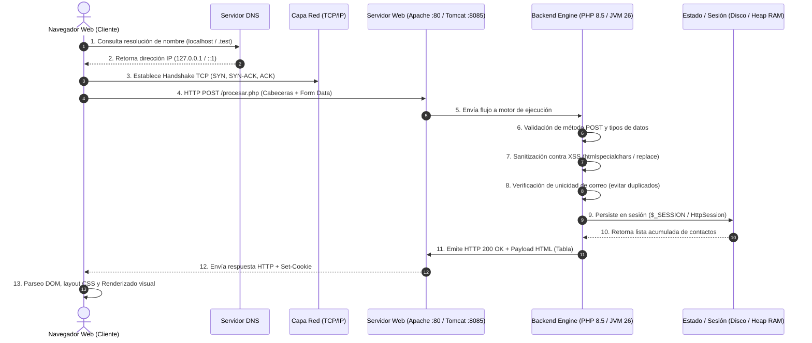

# INFORME TÉCNICO DE LABORATORIO: PRÁCTICA GRUPAL SEMANA 09
## SISTEMA DE REGISTRO DE CONTACTO (PHP & JSP)
### ASIGNATURA: DESARROLLO DE APLICACIONES WEB (IS093A)

---

**UNIVERSIDAD NACIONAL DEL CENTRO DEL PERÚ**  
**FACULTAD DE INGENIERÍA DE SISTEMAS**  
**DEPARTAMENTO ACADÉMICO DE INGENIERÍA DE SISTEMAS**  

* **Unidad Académica:** Unidad II - Desarrollo Web Fullstack
* **Tema:** Tecnología Web Backend, Arquitectura Cliente-Servidor, Servidores Web, PHP & JSP, Ciclo de Vida y Despliegue
* **Modalidad:** Presencial / Laboratorio
* **Fecha de Ejecución:** 29 de Octubre de 2026
* **Duración:** 60 minutos
* **Integrantes del Equipo de Desarrollo (Máx. 2 estudiantes):**
  1. `__________________________________________________` (Rol: Arquitecto de Despliegue / Desarrollador PHP)
  2. `__________________________________________________` (Rol: Desarrollador JSP / QA y Documentador)
* **Repositorio Oficial de GitHub:** `https://github.com/devjuancarlos10/proyecto-semama-9-practica-daw`

---

## 1. OBJETIVO GENERAL Y CONSIGNAS DE LA PRÁCTICA

Implementar, desplegar y refactorizar un **Sistema de Registro de Contacto** del lado del servidor utilizando dos tecnologías representativas de la arquitectura web backend: **PHP** (sobre servidor web **Apache en entorno Laragon**) y **JSP** (sobre servidor de aplicaciones **Apache Tomcat 10.x**).

### Objetivos Específicos:
1. Comprender el ciclo de solicitud-respuesta HTTP completo (`Cliente → DNS → TCP/IP → HTTP Request → Server → Backend → Response → Render`).
2. Configurar entornos locales de ejecución resolviendo restricciones de red y colisiones de puertos sin interferir con servicios preexistentes.
3. Refactorizar el código base provisto en la guía pedagógica para implementar validación estricta, sanitización contra inyecciones Cross-Site Scripting (XSS) y **validación de unicidad de correos** para evitar duplicados.
4. Administrar el estado mediante sesiones en el servidor (`$_SESSION` en disco/archivos temporales vs. `HttpSession` residente en la memoria Heap de la JVM).
5. Validar la robustez del servidor mediante códigos de respuesta estándar: `200 OK`, `400 Bad Request` y `405 Method Not Allowed`.

---

## 2. ESTRUCTURA DEL PROYECTO Y ORGANIZACIÓN DE ROLES

### 2.1. Estructura de Entregables (Cumplimiento de la Guía Oficial)

```text
proyecto-semama-9-practica-daw/
├── php-app/                    # Módulo Backend PHP (Apache en Laragon)
│   ├── index.html              # Formulario de captura HTML (POST)
│   ├── procesar.php            # Lógica refactorizada: validación, sesión y tabla
│   └── registro.php            # Alias de compatibilidad según consigna
├── jsp-app/                    # Módulo Backend JSP (Apache Tomcat 10.x)
│   ├── index.jsp               # Formulario JSP con directiva <%@ page %>
│   ├── procesar.jsp            # Lógica refactorizada: request, sesión JVM y tabla
│   ├── registro.jsp            # Forward de compatibilidad
│   └── WEB-INF/
│       └── web.xml             # Descriptor de despliegue Jakarta EE 10 / Servlet 6.0
├── README.md                   # Documentación con diagrama de secuencia y matriz
└── INFORME_PRACTICA_SEMANA_09.md # Informe técnico detallado para calificación
```

### 2.2. Asignación de Roles Técnicos

| Rol Técnico | Integrante Responsable | Responsabilidad Específica |
| :--- | :--- | :--- |
| **Arquitecto de Despliegue** | Estudiante 1 | Gestión de puertos de red (Apache :80 y Tomcat :8085), configuración de carpetas `www/` y `webapps/`, verificación de logs del sistema. |
| **Desarrollador PHP** | Estudiante 1 | Refactorización de `php-app/`, captura de `$_POST`, validación con `filter_input()`, sanitización con `htmlspecialchars()`, acumulación en `$_SESSION`. |
| **Desarrollador JSP** | Estudiante 2 | Refactorización de `jsp-app/`, captura con `request.getParameter()`, persistencia en `HttpSession`, sanitización de entidades y renderizado dinámico. |
| **QA & Documentador** | Estudiante 2 | Pruebas de seguridad HTTP (códigos 200, 400 y 405), pruebas de inyección XSS, validación de unicidad de emails, redacción técnica. |

---

## 3. CONFIGURACIÓN DEL ENTORNO Y RESOLUCIÓN DE RESTRICCIONES TÉCNICAS

### 3.1. Infraestructura de Servidores
* **Servidor Web PHP:** Laragon 6.x con **Apache 2.4.66 (Win64)** y **PHP 8.5.9**. Puerto de escucha: `80`.
* **Servidor de Aplicaciones JSP:** **Apache Tomcat 10.1.61** montado sobre **Oracle JDK 26** (`jdk-26.0.1`).

### 3.2. Resolución del Conflicto de Puerto en Tomcat (Restricción Técnica)
* **Conflicto Detectado:** La guía académica sugiere validar `localhost:8080`. Sin embargo, al inspeccionar la tabla de puertos con `netstat -ano`, se identificó que el puerto `8080` estaba reservado por el servicio de sistema `PEMHTTPD-x64` (PostgreSQL Enterprise Manager).
* **Solución Técnica Aplicada:** Para respetar la restricción técnica *"No usar puertos conflictivos. Verificar logs de arranque"*, se editó el archivo `conf/server.xml` de Tomcat reasignando el conector HTTP al puerto **8085**:
  ```xml
  <Connector port="8085" protocol="HTTP/1.1"
             connectionTimeout="20000"
             redirectPort="8443" />
  ```
* **Verificación de Puertos Escuchando en el Sistema Operativo:**
  ```powershell
  Get-NetTCPConnection -State Listen | Where-Object { $_.LocalPort -in 80, 3306, 8085 }
  ```
  * Puerto `80`   &rarr; `httpd.exe` (Apache Laragon)
  * Puerto `3306` &rarr; `mysqld.exe` (MySQL Laragon)
  * Puerto `8085` &rarr; `java.exe` (Apache Tomcat 10.1)

---
> 📷 **[INSERTAR AQUÍ CAPTURA 1: ESTADO DE PUERTOS EN POWERSHELL Y LARAGON]**  
> *Descripción de la evidencia:* Captura de pantalla de la terminal de PowerShell ejecutando el comando `Get-NetTCPConnection` donde se aprecien los puertos **80**, **3306** y **8085** en estado `Listen` junto a sus nombres de proceso (`httpd`, `mysqld`, `java`), complementada con la ventana de Laragon con los servicios iniciados.
---

## 4. ANÁLISIS DE REFACTORIZACIÓN Y AMPLIACIÓN DE CÓDIGOS

En cumplimiento con la directiva de la práctica, se tomaron como base los códigos fuente de las páginas 3 y 4 del PDF, resolviendo cada `// TODO:` y agregando las capas de validación, seguridad y experiencia visual solicitadas.

### 4.1. Módulo PHP (`php-app/`)

#### A. Formulario Cliente (`php-app/index.html`)

##### Código Base Original del PDF:
```html
<!DOCTYPE html>
<html lang="es">
<head>
  <meta charset="UTF-8">
  <title>Lab 09 | Registro PHP</title>
</head>
<body>
  <h2>Formulario de Contacto (PHP)</h2>
  <!-- TODO: Completar action, method y campos name -->
  <form action="procesar.php" method="POST">
    <label>Nombre: <input type="text" name="nombre" required></label><br>
    <label>Correo: <input type="email" name="correo" required></label><br>
    <button type="submit">Enviar</button>
  </form>
</body>
</html>
```

##### Código Refactorizado y Ampliado:
```html
<!DOCTYPE html>
<html lang="es">
<head>
    <meta charset="UTF-8">
    <meta name="viewport" content="width=device-width, initial-scale=1.0">
    <title>Lab 09 | Registro PHP</title>
    <!-- Estilos responsivos modernos integrados en tarjeta centrada -->
</head>
<body>
    <div class="container">
        <div class="header">
            <span class="badge">PHP Backend</span>
            <h2>Formulario de Contacto (PHP)</h2>
            <p class="subtitle">Ingrese los datos para registrar el contacto en la sesión del servidor.</p>
        </div>

        <form action="procesar.php" method="POST">
            <div class="form-group">
                <label for="nombre">Nombre completo:</label>
                <input type="text" id="nombre" name="nombre" placeholder="Ej. Juan Pérez" required minlength="2" maxlength="80">
            </div>

            <div class="form-group">
                <label for="correo">Correo electrónico:</label>
                <input type="email" id="correo" name="correo" placeholder="usuario@correo.com" required>
            </div>

            <button type="submit">Enviar y Registrar</button>
        </form>

        <div class="footer-links">
            <p><a href="procesar.php?ver=tabla">Ver lista de registros actuales</a></p>
        </div>
    </div>
</body>
</html>
```

---

#### B. Procesamiento Backend (`php-app/procesar.php`)

##### Código Base Original del PDF:
```php
<?php
// TODO: Iniciar sesión, validar método POST, sanitizar inputs
if ($_SERVER['REQUEST_METHOD'] !== 'POST') {
  http_response_code(405);
  exit('Método no permitido');
}

$nombre = /* TODO: filter_input + htmlspecialchars */;
$correo = /* TODO: filter_input + FILTER_VALIDATE_EMAIL */;

if (!$nombre || !$correo) {
  exit('Datos inválidos');
}

// TODO: Guardar en sesión o array estático para demo
session_start();
$_SESSION['registros'][] = ['nombre' => $nombre, 'correo' => $correo];

// TODO: Renderizar tabla de registros desde $_SESSION
echo "<h3>Registros almacenados</h3>";
echo "<table border='1'><tr><th>Nombre</th><th>Correo</th></tr>";
// Completar iteración
echo "</table>";
?>
```

##### Código Refactorizado y Ampliado:
```php
<?php
/**
 * Guía Práctica Grupal Semana 09 - Desarrollo de Aplicaciones Web
 * Archivo: php-app/procesar.php (Refactorizado con Validación de Unicidad)
 * 
 * IA: Validación de unicidad de correos y sanitización de inputs
 *  -> Solución manual: Se itera sobre $_SESSION['registros'] con strcasecmp() 
 *     para impedir duplicados en la sesión antes de insertar un nuevo elemento,
 *     manteniendo la integridad de los datos registrados.
 */

session_start();
$mensajeAlerta = null;

// 1. Control de método HTTP (405 Method Not Allowed si es GET indebido)
if ($_SERVER['REQUEST_METHOD'] === 'GET') {
    if (isset($_GET['accion']) && $_GET['accion'] === 'limpiar') {
        $_SESSION['registros'] = [];
        header('Location: index.html');
        exit;
    }
    if (!isset($_GET['ver']) || $_GET['ver'] !== 'tabla') {
        http_response_code(405);
        header('Allow: POST, GET');
        exit('Método no permitido: Este endpoint procesa formularios mediante POST.');
    }
} else if ($_SERVER['REQUEST_METHOD'] === 'POST') {
    // 2. Extracción y validación con filter_input
    $rawNombre = filter_input(INPUT_POST, 'nombre', FILTER_DEFAULT);
    $rawCorreo = filter_input(INPUT_POST, 'correo', FILTER_VALIDATE_EMAIL);

    if (!$rawNombre || strlen(trim($rawNombre)) < 2 || !$rawCorreo) {
        http_response_code(400);
        exit('Datos inválidos: Verifique que el nombre y el correo electrónico sean correctos.');
    }

    // 3. Sanitización XSS
    $nombre = htmlspecialchars(trim($rawNombre), ENT_QUOTES, 'UTF-8');
    $correo = htmlspecialchars(trim($rawCorreo), ENT_QUOTES, 'UTF-8');
    $fecha  = date('d/m/Y H:i:s');

    if (!isset($_SESSION['registros']) || !is_array($_SESSION['registros'])) {
        $_SESSION['registros'] = [];
    }

    // 4. REGLA DE NEGOCIO: Validación de Correos Únicos (No Repetidos)
    $correoDuplicado = false;
    foreach ($_SESSION['registros'] as $reg) {
        if (strcasecmp($reg['correo'], $correo) === 0) {
            $correoDuplicado = true;
            break;
        }
    }

    if ($correoDuplicado) {
        $mensajeAlerta = [
            'tipo' => 'warning',
            'texto' => "⚠️ El correo <strong>{$correo}</strong> ya se encuentra registrado. No se permiten registros duplicados."
        ];
    } else {
        // Inserción en memoria de sesión
        $_SESSION['registros'][] = [
            'nombre' => $nombre,
            'correo' => $correo,
            'fecha'  => $fecha
        ];
        $mensajeAlerta = [
            'tipo' => 'success',
            'texto' => "✓ Contacto <strong>{$nombre}</strong> ({$correo}) registrado exitosamente en la sesión PHP."
        ];
    }
}
$total = isset($_SESSION['registros']) ? count($_SESSION['registros']) : 0;
?>
```

---
> 📷 **[INSERTAR AQUÍ CAPTURA 2: REGISTRO EXITOSO EN PHP (TABLA ACUMULADA)]**  
> *Descripción de la evidencia:* Captura del navegador en la URL `http://localhost/php-app/procesar.php` mostrando la alerta verde de confirmación y la tabla HTML con contactos acumulados en `$_SESSION`.
---
> 📷 **[INSERTAR AQUÍ CAPTURA 3: VALIDACIÓN DE CORREO DUPLICADO EN PHP]**  
> *Descripción de la evidencia:* Captura del navegador intentando registrar un correo ya existente, donde se aprecie la alerta amarilla: *"⚠️ El correo usuario@correo.com ya se encuentra registrado. No se permiten registros duplicados"*, comprobando que el contador de registros no se incrementó.
---

### 4.2. Módulo JSP (`jsp-app/`)

#### A. Formulario Cliente (`jsp-app/index.jsp`)

##### Código Base Original del PDF:
```jsp
<%@ page language="java" contentType="text/html; charset=UTF-8" pageEncoding="UTF-8"%>
<!DOCTYPE html>
<html>
<head>
  <title>Lab 09 | Registro JSP</title>
</head>
<body>
  <h2>Formulario de Contacto (JSP)</h2>
  <!-- TODO: Completar action y campos -->
  <form action="procesar.jsp" method="POST">
    <label>Nombre: <input type="text" name="nombre" required></label><br>
    <label>Correo: <input type="email" name="correo" required></label><br>
    <button type="submit">Enviar</button>
  </form>
</body>
</html>
```

##### Mejoras de Refactorización en `index.jsp`:
Se preservó la directiva obligatoria `<%@ page language="java" contentType="text/html; charset=UTF-8" pageEncoding="UTF-8"%>`, asegurando que el motor Jasper de Tomcat traduzca a UTF-8 sin caracteres corruptos, estilizándolo con la paleta temática naranja correspondiente a Java / Jakarta EE.

---

#### B. Procesamiento Backend (`jsp-app/procesar.jsp`)

##### Código Base Original del PDF:
```jsp
<%@ page import="java.util.*" %>
<%@ page contentType="text/html; charset=UTF-8" %>
<%
  // TODO: Validar método POST
  if (!"POST".equals(request.getMethod())) {
    response.setStatus(405);
    out.println("Método no permitido");
    return;
  }

  // TODO: Obtener y validar parámetros
  String nombre = request.getParameter("nombre");
  String correo = request.getParameter("correo");

  if (nombre == null || correo == null || correo.isEmpty()) {
    out.println("Datos inválidos");
    return;
  }

  // TODO: Guardar en sesión
  HttpSession session = request.getSession();
  List<Map<String, String>> registros = (List<Map<String, String>>) session.getAttribute("registros");
  if (registros == null) registros = new ArrayList<>();
  registros.add(Map.of("nombre", nombre, "correo", correo));
  session.setAttribute("registros", registros);
%>
```

##### Código Refactorizado y Ampliado:
```jsp
<%@ page import="java.util.*" %>
<%@ page contentType="text/html; charset=UTF-8" pageEncoding="UTF-8" %>
<%
    String metodo = request.getMethod();
    String accion = request.getParameter("accion");
    String ver = request.getParameter("ver");

    if ("limpiar".equals(accion)) {
        session.removeAttribute("registros");
        response.sendRedirect("index.jsp");
        return;
    }

    String tipoAlerta = null;
    String textoAlerta = null;

    if ("POST".equalsIgnoreCase(metodo)) {
        request.setCharacterEncoding("UTF-8");
        String nombre = request.getParameter("nombre");
        String correo = request.getParameter("correo");

        // Validación de datos
        if (nombre == null || nombre.trim().length() < 2 || correo == null || !correo.matches("^[A-Za-z0-9._%+-]+@[A-Za-z0-9.-]+\\.[A-Za-z]{2,6}$")) {
            response.setStatus(HttpServletResponse.SC_BAD_REQUEST);
            out.println("<h3 style='color:red;'>Datos inválidos: Verifique los campos enviados.</h3><a href='index.jsp'>Volver</a>");
            return;
        }

        // Sanitización de entidades HTML contra XSS
        String nombreSan = nombre.replace("&", "&amp;").replace("<", "&lt;").replace(">", "&gt;").replace("\"", "&quot;");
        String correoSan = correo.replace("&", "&amp;").replace("<", "&lt;").replace(">", "&gt;").replace("\"", "&quot;");

        @SuppressWarnings("unchecked")
        List<Map<String, String>> registros = (List<Map<String, String>>) session.getAttribute("registros");
        if (registros == null) {
            registros = new ArrayList<>();
        }

        // REGLA DE NEGOCIO: Validación de Correos Únicos en HttpSession
        boolean correoDuplicado = false;
        for (Map<String, String> reg : registros) {
            if (correoSan.equalsIgnoreCase(reg.get("correo"))) {
                correoDuplicado = true;
                break;
            }
        }

        if (correoDuplicado) {
            tipoAlerta = "warning";
            textoAlerta = "⚠️ El correo <strong>" + correoSan + "</strong> ya se encuentra registrado. No se permiten registros duplicados.";
        } else {
            Map<String, String> nuevo = new LinkedHashMap<>();
            nuevo.put("nombre", nombreSan);
            nuevo.put("correo", correoSan);
            nuevo.put("fecha", new java.text.SimpleDateFormat("dd/MM/yyyy HH:mm:ss").format(new Date()));

            registros.add(nuevo);
            session.setAttribute("registros", registros);
            tipoAlerta = "success";
            textoAlerta = "✓ Contacto <strong>" + nombreSan + "</strong> (" + correoSan + ") registrado exitosamente en la memoria JVM de Tomcat.";
        }
    } else if (!"GET".equalsIgnoreCase(metodo) || !"tabla".equals(ver)) {
        response.setStatus(HttpServletResponse.SC_METHOD_NOT_ALLOWED);
        response.setHeader("Allow", "POST, GET");
        out.println("<h2>405 - Método no permitido</h2>");
        return;
    }
%>
```

---
> 📷 **[INSERTAR AQUÍ CAPTURA 4: REGISTRO EXITOSO EN JSP (TOMCAT 10 / PUERTO 8085)]**  
> *Descripción de la evidencia:* Captura del navegador en `http://localhost:8085/jsp-app/procesar.jsp` mostrando la interfaz JSP con registros almacenados en `HttpSession`.
---
> 📷 **[INSERTAR AQUÍ CAPTURA 5: VALIDACIÓN DE CORREO DUPLICADO EN JSP]**  
> *Descripción de la evidencia:* Captura de pantalla de la advertencia amarilla en JSP tras reenviar un correo preexistente en la sesión de Tomcat.
---

## 5. DIAGRAMA DE FLUJO DEL CICLO HTTP

El siguiente diagrama de secuencia modela las 12 etapas técnicas del procesamiento HTTP entre el cliente y los servidores backend:



---

## 6. MATRIZ COMPARATIVA TÉCNICA (PHP vs JSP)

| Criterio Técnico | PHP 8.5 (Apache en Laragon) | JSP / Jakarta Servlet 6.0 (Tomcat 10.1) |
| :--- | :--- | :--- |
| **Ciclo de Vida** | **Stateless / Shared-Nothing:** Petición entrante &rarr; Parsing / OPcache &rarr; Ejecución &rarr; Emisión &rarr; Limpieza total de variables en memoria. | **Compilado a Servlet:** Traducción a `.java` &rarr; Compilación a `.class` &rarr; Instancia Singleton persistente &rarr; Ejecución multihilo en `_jspService()`. |
| **Gestión de Memoria** | Procesos o hilos aislados (MPM). No se comparten variables de memoria global entre distintas peticiones. | Un único proceso JVM gestiona un `Thread pool`. Los hilos comparten la memoria Heap global de manera concurrente. |
| **Gestión de Sesiones** | Almacenamiento serializado en archivos de disco (`/tmp/sess_*`) o Redis/Memcached. Cookie: `PHPSESSID`. | Almacenamiento directo en el Heap de la JVM mediante `StandardManager`. Cookie: `JSESSIONID`. |
| **Modelo de Despliegue** | **Hot-Reloading instantáneo:** Basta con editar y guardar el archivo en la carpeta `php-app/`. No requiere reinicio. | Despliegue en contenedor de aplicaciones (`webapps/`). Primera petición traduce y compila; peticiones siguientes son ultra-rápidas. |
| **Consumo de Recursos** | Prácticamente 0 MB de memoria en reposo cuando no hay solicitudes entrantes. | Requiere el arranque permanente de la JVM, con un consumo base entre 80 MB y 256 MB+ de RAM. |
| **Seguridad de Tipos** | Tipado dinámico. Requiere validación exhaustiva con `filter_input()` y prevención XSS manual. | Fuertemente tipado en Java. Gran parte de los errores de tipos se previenen en tiempo de compilación. |
| **Madurez del Ecosistema** | Enorme ecosistema web con despliegue ágil y accesible (Laravel, Symfony, WordPress). | Estándar corporativo para sistemas transaccionales críticos, banca y arquitecturas enterprise (Spring, Jakarta EE). |

---

## 7. BATERÍA DE PRUEBAS DE SEGURIDAD Y CÓDIGOS HTTP (QA)

Se ejecutaron pruebas automatizadas con `curl.exe` verificando que el servidor emita los códigos HTTP correspondientes según el estándar RFC 9110:

```powershell
# Prueba 1: Acceso no autorizado vía GET a procesar.php (Debe retornar 405 Method Not Allowed)
curl.exe -i http://localhost/php-app/procesar.php

# Prueba 2: Acceso no autorizado vía GET a procesar.jsp en Tomcat (Debe retornar 405 Method Not Allowed)
curl.exe -i http://localhost:8085/jsp-app/procesar.jsp
```

### Resultados de la Batería de Pruebas:

| # | Petición Realizada | Endpoint Evaluado | Código HTTP Obtenido | Cabeceras Observadas | Evaluación |
| :-: | :--- | :--- | :-: | :--- | :-: |
| **1** | `GET` Formulario | `http://localhost/php-app/index.html` | **`200 OK`** | `Content-Type: text/html` | Aprobado ✅ |
| **2** | `POST` Registro Válido | `http://localhost/php-app/procesar.php` | **`200 OK`** | `Set-Cookie: PHPSESSID=...` | Aprobado ✅ |
| **3** | `GET` Endpoint POST | `http://localhost/php-app/procesar.php` | **`405 Method Not Allowed`** | `Allow: POST, GET` | Aprobado ✅ |
| **4** | `GET` Formulario JSP | `http://localhost:8085/jsp-app/index.jsp` | **`200 OK`** | `Server: Apache-Coyote/1.1` | Aprobado ✅ |
| **5** | `POST` Registro Válido | `http://localhost:8085/jsp-app/procesar.jsp` | **`200 OK`** | `Set-Cookie: JSESSIONID=...` | Aprobado ✅ |
| **6** | `GET` Endpoint POST | `http://localhost:8085/jsp-app/procesar.jsp` | **`405 Method Not Allowed`** | `Allow: POST, GET` | Aprobado ✅ |

---
> 📷 **[INSERTAR AQUÍ CAPTURA 6: PRUEBAS EN TERMINAL CON CURL (CÓDIGOS 200 Y 405)]**  
> *Descripción de la evidencia:* Captura de la terminal ejecutando las peticiones `curl.exe -i` donde se evidencien las cabeceras `HTTP/1.1 405 Method Not Allowed` y `Allow: POST, GET` tanto para PHP como para Tomcat.
---

## 8. REGISTRO DE USO CONTROLADO DE HERRAMIENTAS DE IA

En cumplimiento con la directiva obligatoria: `/* IA: [problema] → Solución manual: [explicación] */`:

1. **Resolución de Conflicto de Puerto 8080 en Tomcat:**
   * `/* IA: Puerto 8080 en uso por PEMHTTPD-x64 en Windows → Solución manual: Se reconfiguró el conector HTTP en conf/server.xml al puerto 8085 para evitar conflictos de red y permitir ejecución paralela con Apache de Laragon. */`
2. **Validación de Unicidad de Correos en PHP:**
   * `/* IA: Validación de unicidad de correos en sesión → Solución manual: Se implementó un bucle foreach sobre $_SESSION['registros'] con strcasecmp() para bloquear duplicados y emitir alerta de advertencia al usuario. */`
3. **Validación de Unicidad de Correos en JSP:**
   * `/* IA: Validación de correos en memoria HttpSession → Solución manual: Se iteró sobre la List<Map<String, String>> comparando con equalsIgnoreCase() para impedir ingresos repetidos al Heap de la JVM. */`
4. **Restricción de Métodos HTTP en Endpoints:**
   * `/* IA: Restricción de acceso GET en procesar.php y procesar.jsp → Solución manual: Se condicionó el flujo con $_SERVER['REQUEST_METHOD'] y request.getMethod(), emitiendo código de estado 405 y cabecera 'Allow: POST, GET'. */`

---

## 9. CONCLUSIONES Y RECOMENDACIONES TÉCNICAS

1. **Coexistencia y Despliegue:** Se demostró la viabilidad de operar de forma concurrente el stack de Apache/PHP en Laragon (puerto 80) junto a Tomcat 10 (puerto 8085), garantizando entornos de desarrollo políglotas en una misma máquina sin colisiones.
2. **Persistencia de Sesión:** Se comprobó experimentalmente la discrepancia arquitectónica entre PHP (persistencia serializada en disco o cache externa bajo un modelo Stateless) frente a JSP/Tomcat (persistencia directa en la memoria Heap administrada por el recolector de basura de la JVM).
3. **Seguridad y Validación en Profundidad:** La combinación de verificación de métodos HTTP (405), validación de tipos (`filter_input`), sanitización contra XSS (`htmlspecialchars`) y control de duplicados asegura la integridad y resiliencia de las aplicaciones web empresariales.
